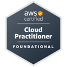

# Leonardo Rodrigues Paixão
### Arquiteto de Infraestrutura | Cloud, Ambientes Híbridos, IaC (Terraform) & Arquitetura para IA

**Português** • [English Version](#-english-version)

  

&nbsp;&nbsp;&nbsp;

&nbsp;&nbsp;&nbsp;

&nbsp;&nbsp;&nbsp;

---

## Sobre Mim

Arquiteto de Infraestrutura com mais de 4 anos de experiência em instituição financeira de grande porte, atuando como referência técnica e consultor corporativo no desenho, governança e evolução de ambientes críticos **On-Premises, Multicloud (AWS, Azure, GCP) e Topologias Híbridas**.

Minha atuação conecta a visão estratégica de arquitetura à entrega prática, segura e escalável de engenharia:

* **Curadoria Cloud Native & Catálogo de Prateleira:** Domínio de ecossistemas e serviços gerenciados **Cloud Native** (AWS, Azure e GCP), utilizando **documentações oficiais** e boas práticas dos provedores para definir padrões corporativos "de prateleira" prontos para adoção, resolvendo gargalos que impactam o negócio e direcionando cada demanda para o melhor custo-benefício tecnológico.
* **Industrialização & Self-Service IaC:** Liderança técnica na concepção, **Discovery**, **PoC**, homologação e entrega de soluções corporativas em **Infrastructure as Code (Terraform)**, definindo diretrizes e guardrails de segurança e custos (**FinOps**) para consumo autônomo pelas squads de engenharia.
* **Arquitetura para IA Corporativa & Agentes Autônomos:** Definição e desenho de arquiteturas de referência para **Agentes de IA** aplicados a processos corporativos, estruturando padrões de orquestração e integração segura com bases de conhecimento. Apoiar no direcionamento de governança de consumo de inferência e mitigação de *vendor lock-in* entre provedores de LLMs).
* **Governança & Os 6 Pilares de IA Responsável:** Aplicação prática dos princípios de **Responsible AI** na arquitetura e homologação de soluções generativas em ambientes regulados: **Equidade** (*Fairness*), **Confiabilidade e Segurança** (*Reliability & Safety*), **Privacidade e Proteção de Dados** (*Privacy & Security*), **Inclusão** (*Inclusiveness*), **Transparência** (*Transparency*) e **Responsabilidade/Auditoria** (*Accountability*).
* **Conectividade Privada SaaS, M&A & Redes Híbridas:** Desenho de infraestrutura para integração privada de plataformas corporativas via canais internos dedicados, eliminando exposição à internet pública e prevendo escalabilidade de tráfego e endereçamento IP para crescimento contínuo. Atuação na definição de **redes virtuais estendidas** para integração segura em processos de **fusão de empresas (M&A)** do mesmo grupo, além de topologias **Hub-Spoke**, **DMZ** e governança de saída (*egress*).
* **Segurança Conceitual, Zero Trust & Well-Architected Framework:** Concepção de arquiteturas fundamentadas nos princípios de **Zero Trust** (verificação explícita, acesso de privilégio mínimo e assunção de violação com microssegmentação) e nos **6 pilares do Well-Architected Framework** (**Excelência Operacional, Segurança, Confiabilidade, Eficiência de Performance, Otimização de Custos e Sustentabilidade**).
* **Governança & Movimentação Crítica de Dados:** Desenho de estratégias de transferência e migração de grandes volumes de dados (On-Premises para SaaS em ondas com zero impacto operacional, Cloud e ingestão regulatória de parceiros externos) garantindo continuidade de negócio.
* **Auditoria & Arquiteturas Event-Driven:** Ponto focal técnico na remediação de auditorias corporativas e regulatórias de alta criticidade, além da concepção de pipelines serverless orientados a eventos (como inspeção automatizada antimalware em buckets com custo sob demanda).
* **Governança Corporativa & Pareceres Técnicos:** Representação como cadeira técnica votante em Fóruns de Arquitetura, emissão de pareceres formais para aquisições/renovações (SaaS, PaaS, IA e On-Premises), condução de PoCs/testes de estresse e definição de requisitos mínimos de homologação para tecnologias e sistemas operacionais (Linux, Windows Server e Unix/Solaris).
* **Documentação & Artefatos de Arquitetura:** Elaboração de arquiteturas de referência, visões executivas (**HLD — High-Level Design**), especificações detalhadas para engenharia (**LLD — Low-Level Design**), registros de decisão (**ADRs — Architecture Decision Records**), **Blueprints**, diagramas técnicos (**Draw.io**) e guias operacionais.

---

## 🏗️ Blueprints de Arquitetura em Destaque (Terraform & Cloud)

> *Todos os repositórios abaixo representam padrões arquiteturais agnósticos inspirados em desafios reais de ambientes corporativos críticos, materializados em Infrastructure as Code (Terraform) e documentados com práticas de mercado (HLD/LLD, Blueprints, ADRs e diagramas Draw.io).*

| Repositório (Blueprint) | Foco Arquitetural & Valor de Negócio | Stack Principal |
| :--- | :--- | :--- |
| **[`aws-selfservice-data-transfer-blueprint`](https://github.com/leo-arquiteto/aws-selfservice-data-transfer-blueprint)** | **Governança & Industrialização de Transferência de Dados:** Módulo *Self-Service* para ingestão e migração crítica de dados com políticas automatizadas de ciclo de vida (FinOps), criptografia KMS e IAM de privilégio mínimo. | `Terraform` • `AWS DataSync` • `S3` • `KMS` • `IAM` |
| **[`gcp-event-driven-antimalware-pipeline`](#)** | **Arquitetura Segura de Transferência & Antimalware Serverless:** Esteira orientada a eventos na GCP para inspeção automatizada de arquivos externos em quarentena antes da promoção para buckets produtivos, com custo sob demanda. | `Terraform` • `Cloud Storage` • `Eventarc` • `Cloud Run` • `ClamAV` |
| **[`aws-hybrid-hub-spoke-landing-zone`](#)** | **Conectividade Híbrida & Segmentação de Redes:** Topologia *Hub-and-Spoke* multi-VPC com governança centralizada de tráfego de saída (*egress*), isolamento DMZ, conectividade privada SaaS e interconexão *on-premises*. | `Terraform` • `Transit Gateway` • `VPC` • `PrivateLink` • `Direct Connect` |

---

## 🛠️ Matriz de Competências Técnicas

| Domínio Arquitetural | Tecnologias, Padrões e Entregáveis |
| :--- | :--- |
| **Arquitetura Cloud & Cloud Native** | Multicloud (AWS, Azure, GCP), Serviços Gerenciados & Serverless, Curadoria de Tecnologias de Prateleira via Documentação Oficial, Landing Zones, Alta Disponibilidade (HA) e Mitigação de Vendor Lock-in |
| **Fundamentos Conceituais & Segurança** | **Zero Trust Architecture** (Privilégio Mínimo, Microssegmentação, Verificação Explícita) e **6 Pilares do Well-Architected Framework** (Excelência Operacional, Segurança, Confiabilidade, Eficiência de Performance, Otimização de Custos e Sustentabilidade) |
| **Arquitetura & Governança de IA** | Agentes de IA Corporativos, RAG, AI Gateways, Guardrails de Segurança, FinOps para LLMs e os **6 Pilares de IA Responsável** (Equidade, Confiabilidade/Segurança, Privacidade/Proteção, Inclusão, Transparência e Responsabilidade) |
| **Conectividade, M&A & Redes** | Redes Virtuais Estendidas (M&A), Conectividade Privada SaaS/BPM (Pega Cloud / PrivateLink sem internet pública), Interconexão Híbrida (Direct Connect, ExpressRoute, VPN IPsec), Topologias Hub-Spoke, DMZ e Governança de Egress |
| **Automação & Industrialização** | Infrastructure as Code (Terraform — Design Modular, Remote State, CI/CD Guardrails), Soluções Self-Service, Arquiteturas Event-Driven e Serverless |
| **Sistemas Core & Plataformas** | Linux (Red Hat, Ubuntu, CentOS), Unix (Solaris), Windows Server, Ambientes Virtualizados, Hardening e Homologação Técnica de SOs |
| **Governança, Riscos & FinOps** | HLD / LLD, Blueprints, ADRs (Architecture Decision Records), Draw.io, Remediação de Auditorias Críticas, Pareceres Técnicos de Aquisição e Fóruns de Arquitetura |

---

## English Version

Infrastructure Architect with 4+ years of experience in a major financial institution, acting as a technical reference and corporate advisor in designing, governing, and evolving enterprise **On-Premises, Multicloud (AWS, Azure, GCP), and Hybrid Topologies**.

My work bridges high-level architectural governance with industrialized, resilient engineering delivery:

* **Cloud Native Curation & Off-the-Shelf Standards:** Deep expertise across **Cloud Native** managed ecosystems (AWS, Azure, and GCP), leveraging **official vendor documentation** and best practices to establish ready-to-use ("off-the-shelf") corporate standards, solving business bottlenecks and guiding workloads toward the most effective technology fit.
* **Self-Service IaC & Industrialization:** Technical leadership across **Discovery**, **PoC**, technical validation, and delivery of industrialized **Infrastructure as Code (Terraform)** capabilities, establishing security guardrails and **FinOps** cost controls for autonomous consumption by engineering squads.
* **Enterprise AI Architecture & Autonomous Agents:** Defining reference architectures for **AI Agents** in enterprise workflows, covering orchestration patterns, secure knowledge base integration (**RAG / Vector Databases**), **AI Gateways**, network isolation, observability, and **AI FinOps** (inference token governance and LLM vendor lock-in mitigation).
* **Governance & The 6 Pillars of Responsible AI:** Operationalizing **Responsible AI** principles across regulated enterprise architectures: **Fairness**, **Reliability & Safety**, **Privacy & Security**, **Inclusiveness**, **Transparency**, and **Accountability**.
* **Private SaaS Connectivity, M&A & Hybrid Networks:** Designing private internal network architectures for enterprise **BPM SaaS platforms (such as Pega Cloud)** using dedicated private endpoints (*PrivateLink / Peering*), eliminating public internet exposure while engineering IP capacity and throughput scalability for future growth. Led **extended virtual network** designs for corporate **mergers & acquisitions (M&A)** within the group, alongside **Hub-Spoke**, **DMZ**, and egress traffic governance.
* **Security Foundations, Zero Trust & Well-Architected Framework:** Designing resilient architectures anchored on **Zero Trust** principles (explicit verification, least privilege access, and assume-breach micro-segmentation) and the **6 Pillars of the Well-Architected Framework** (**Operational Excellence, Security, Reliability, Performance Efficiency, Cost Optimization, and Sustainability**).
* **Critical Data Transfer Governance:** Designing scalable strategies for large-scale data movement and ingestion (phased on-premises to SaaS migrations with zero operational impact, cloud, and regulatory bulk ingestion from external partners).
* **Audit Remediation & Event-Driven Pipelines:** Technical focal point for high-criticality corporate and regulatory audits, plus designing serverless event-driven architectures (such as automated bucket antimalware scanning with on-demand cost optimization).
* **Enterprise Governance & Technical Assessments:** Voting technical seat in Architecture Forums, formal technical assessments for SaaS/PaaS/AI/On-Premises acquisitions, stress-testing PoCs, and minimum technical qualification criteria for technologies and OS platforms (Linux, Windows Server, Unix/Solaris).
* **Architectural Documentation & Artifacts:** Authoring reference architectures, executive **High-Level Designs (HLD)**, engineering **Low-Level Designs (LLD)**, **Architecture Decision Records (ADRs)**, **Blueprints**, technical diagrams (**Draw.io**), and operational guides.

*(See the featured Terraform repositories table above for hands-on architectural implementations.)*
