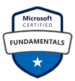

# Leonardo Rodrigues Paixão
### Arquiteto de Infraestrutura | Cloud, Ambientes Híbridos e Infraestrutura como Código (Terraform)

**Português** • [English Version](#-english-version)

  

&nbsp;&nbsp;&nbsp;

&nbsp;&nbsp;&nbsp;

&nbsp;&nbsp;&nbsp;

---

## Sobre Mim

Arquiteto de Infraestrutura com mais de 4 anos de experiência em instituição financeira de grande porte, atuando no desenho, governança e evolução de ambientes corporativos **On-Premises, Multicloud (AWS, Azure, GCP) e Topologias Híbridas**.

Meu trabalho conecta a visão estratégica de arquitetura à entrega prática e automatizada de engenharia:
* **Industrialização & Self-Service IaC:** Especificação de padrões e blueprints em **Terraform** para entrega de serviços corporativos autônomos com guardrails de segurança e otimização de custos (FinOps).
* **Governança & Movimentação Crítica de Dados:** Desenho de estratégias escaláveis para transferência e ingestão de grandes volumes de dados (On-Prem, Cloud, SaaS e parceiros externos) sob requisitos regulatórios e de continuidade de negócio.
* **Segurança, Auditoria & Resiliência:** Atuação como ponto focal técnico na remediação de auditorias críticas, mitigação de *vendor lock-in*, segmentação de redes (Hub-Spoke / DMZ) e arquiteturas *event-driven*.
* **Framework de Arquitetura de Referência:** Estruturação de modelos corporativos de documentação em 4 níveis: *Capacidade Arquitetural, Objeto/Artefato, Cenários de Uso e Guia de Tecnologia*.

---

## 🏗️ Blueprints de Arquitetura em Destaque (Terraform & Multicloud)

> *Todos os repositórios abaixo representam padrões arquiteturais agnósticos inspirados em desafios reais de ambientes corporativos críticos, materializados em Infrastructure as Code (Terraform) e documentados sob um modelo de referência em 4 camadas.*

| Repositório (Blueprint) | Foco Arquitetural & Valor de Negócio | Stack Principal |
| :--- | :--- | :--- |
| **[`aws-selfservice-data-transfer-blueprint`](https://github.com/leo-arquiteto/aws-selfservice-data-transfer-blueprint)** | **Governança & Industrialização de Transferência de Dados:** Módulo *Self-Service* para ingestão e migração crítica de dados com políticas automatizadas de ciclo de vida (FinOps), criptografia KMS e IAM de privilégio mínimo. | `Terraform` • `AWS DataSync` • `S3` • `KMS` • `IAM` |
| **[`gcp-event-driven-antimalware-pipeline`](https://github.com/leo-arquiteto/gcp-event-driven-antimalware-pipeline)** | **Arquitetura Segura de Transferência & Antimalware Serverless:** Esteira orientada a eventos na GCP para inspeção automatizada de arquivos externos em quarentena antes da promoção para buckets produtivos, com escala zero e custo sob demanda. | `Terraform` • `Cloud Storage` • `Eventarc` • `Cloud Run` • `ClamAV` |
| **[`aws-hybrid-hub-spoke-landing-zone`](https://github.com/leo-arquiteto/aws-hybrid-hub-spoke-landing-zone)** | **Conectividade Híbrida & Segmentação de Redes:** Topologia *Hub-and-Spoke* multi-VPC com governança centralizada de tráfego de saída (*egress*), isolamento DMZ e interconexão *on-premises*. | `Terraform` • `Transit Gateway` • `VPC` • `VPN/Direct Connect` |

---

## 🛠️ Stack Técnica Principal

* **Arquitetura Cloud & Híbrida:** AWS, GCP, Azure, Landing Zones, Well-Architected Framework, Hub-Spoke, Direct Connect / ExpressRoute / VPN IPsec
* **Automação & IaC:** Terraform (Design Modular, Remote State, Guardrails em CI/CD), Arquiteturas Event-Driven e Serverless
* **Sistemas Core & Plataformas:** Linux (RHEL, Ubuntu, CentOS), Unix (Solaris), Windows Server, Hardening e Homologação Técnica de SOs
* **Governança, Riscos & FinOps:** Documentação em Níveis (LLD / Blueprints), Remediação de Auditorias Críticas, Mitigação de Vendor Lock-in e Pareceres Técnicos

---

## English Version

Infrastructure Architect with 4+ years of experience in a major financial institution, specializing in designing, governing, and evolving enterprise **On-Premises, Multicloud (AWS, Azure, GCP), and Hybrid Topologies**.

* **Self-Service IaC & Industrialization:** Defining **Terraform** blueprints and pipeline standards to deliver autonomous enterprise infrastructure with built-in FinOps and security controls.
* **Critical Data Transfer Governance:** Designing resilient, compliant architectures for large-scale data ingestion and migration across on-prem, cloud, SaaS, and external partners.
* **Security, Audit Remediation & Resilience:** Technical focal point for high-criticality regulatory audits, vendor lock-in mitigation, network segmentation (Hub-Spoke/DMZ), and serverless event-driven security pipelines.
* **Layered Reference Architecture:** Creator of a 4-tier enterprise documentation framework (*Architectural Capability, Object/Artifact, Use Scenarios, and Technology Guide*).

*(See the featured Terraform repositories table above for hands-on architectural implementations.)*
