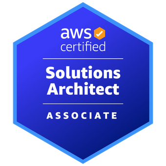
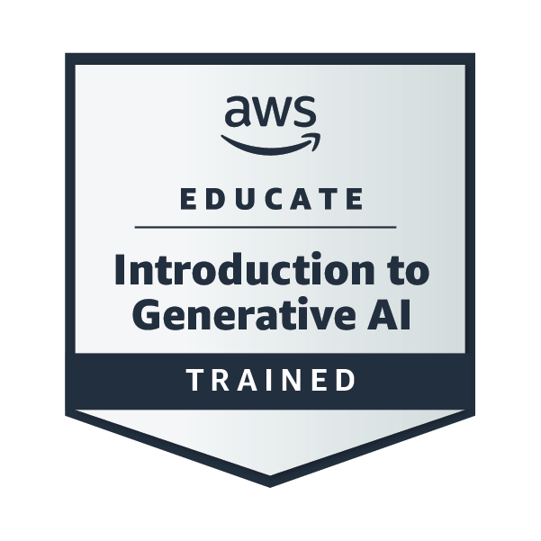

# Leonardo Rodrigues Paixão
### Arquiteto de Infraestrutura | Cloud, Ambientes Híbridos e Infraestrutura como Código (Terraform)

**Português** • [English Version](#-english-version)

  

&nbsp;&nbsp;&nbsp;

&nbsp;&nbsp;&nbsp;

&nbsp;&nbsp;&nbsp;

---

## Sobre Mim

Arquiteto de Infraestrutura com mais de 4 anos de experiência em instituição financeira de grande porte, atuando como referência técnica e consultor corporativo no desenho, governança e evolução de ambientes críticos **On-Premises, Multicloud (AWS, Azure, GCP) e Topologias Híbridas**.

Minha atuação conecta a visão estratégica de arquitetura à entrega prática, segura e escalável de engenharia:

* **Industrialização & Self-Service IaC:** Liderança técnica de ponta a ponta (Discovery, PoC e implantação em DEV, UAT e PRD) e especificação de diretrizes para esteiras de **Infrastructure as Code (Terraform)**, entregando serviços corporativos autônomos com guardrails de segurança e controle de custos (**FinOps**).
* **Governança & Movimentação Crítica de Dados:** Desenho de estratégias de transferência e migração de grandes volumes de dados (On-Premises para SaaS em ondas com zero impacto operacional, Cloud e ingestão regulatória de parceiros externos) garantindo continuidade de negócio.
* **Estratégia Multicloud, Conectividade & Redução de Lock-in:** Definição de padrões de interconexão segura inter-cloud e híbrida, governança de tráfego de saída (*egress*), segmentação de redes (**Hub-Spoke / DMZ**) e mitigação de dependência tecnológica (*vendor lock-in*).
* **Segurança, Auditoria & Arquiteturas Event-Driven:** Ponto focal técnico na remediação de auditorias corporativas e regulatórias de alta criticidade, além da concepção de pipelines serverless orientados a eventos (como inspeção automatizada antimalware em buckets com custo sob demanda).
* **Governança Corporativa & Pareceres Técnicos:** Representação como cadeira técnica votante em Fóruns de Arquitetura, emissão de pareceres formais para aquisições/renovações (SaaS, PaaS e On-Premises), condução de PoCs/testes de estresse e definição de requisitos mínimos de homologação para tecnologias e sistemas operacionais (Linux, Windows Server e Unix/Solaris).
* **Framework de Arquitetura de Referência:** Criação e padronização de documentação hierárquica em 4 níveis (*Capacidade Arquitetural, Objeto/Artefato, Cenários de Uso e Guia de Tecnologia*), além de visões executivas e **LLDs (Low-Level Designs)** para squads de engenharia.

---

## 🏗️ Blueprints de Arquitetura em Destaque (Terraform & Cloud)

> *Todos os repositórios abaixo representam padrões arquiteturais agnósticos inspirados em desafios reais de ambientes corporativos críticos, materializados em Infrastructure as Code (Terraform) e documentados sob um modelo de referência em 4 camadas.*

| Repositório (Blueprint) | Foco Arquitetural & Valor de Negócio | Stack Principal |
| :--- | :--- | :--- |
| **[`aws-selfservice-data-transfer-blueprint`](#)** | **Governança & Industrialização de Transferência de Dados:** Módulo *Self-Service* para ingestão e migração crítica de dados com políticas automatizadas de ciclo de vida (FinOps), criptografia KMS e IAM de privilégio mínimo. | `Terraform` • `AWS DataSync` • `S3` • `KMS` • `IAM` |
| **[`gcp-event-driven-antimalware-pipeline`](#)** | **Arquitetura Segura de Transferência & Antimalware Serverless:** Esteira orientada a eventos na GCP para inspeção automatizada de arquivos externos em quarentena antes da promoção para buckets produtivos, com custo sob demanda. | `Terraform` • `Cloud Storage` • `Eventarc` • `Cloud Run` • `ClamAV` |
| **[`aws-hybrid-hub-spoke-landing-zone`](#)** | **Conectividade Híbrida & Segmentação de Redes:** Topologia *Hub-and-Spoke* multi-VPC com governança centralizada de tráfego de saída (*egress*), isolamento DMZ e interconexão *on-premises*. | `Terraform` • `Transit Gateway` • `VPC` • `VPN/Direct Connect` |

---

## 🛠️ Matriz de Competências Técnicas

| Domínio Arquitetural | Tecnologias, Padrões e Entregáveis |
| :--- | :--- |
| **Arquitetura Cloud & Híbrida** | Multicloud (AWS, Azure, GCP), Well-Architected Framework, Landing Zones, Alta Disponibilidade (HA), Resiliência e Mitigação de Vendor Lock-in |
| **Conectividade & Redes Corporativas** | Interconexão Híbrida (Direct Connect, ExpressRoute, VPN IPsec), Topologias Hub-Spoke, Segmentação de Redes, DMZ, Load Balancing e Governança de Egress |
| **Automação & Industrialização** | Infrastructure as Code (Terraform — Design Modular, Remote State, CI/CD Guardrails), Soluções Self-Service, Arquiteturas Event-Driven e Serverless |
| **Sistemas Core & Plataformas** | Linux (Red Hat, Ubuntu, CentOS), Unix (Solaris), Windows Server, Ambientes Virtualizados, Hardening e Homologação Técnica de SOs |
| **Governança, Riscos & FinOps** | Documentação em 4 Níveis, LLD, Blueprints, Remediação de Auditorias Críticas, Pareceres Técnicos de Aquisição, PoCs e Fóruns de Arquitetura |

---

## English Version

Infrastructure Architect with 4+ years of experience in a major financial institution, acting as a technical reference and corporate advisor in designing, governing, and evolving enterprise **On-Premises, Multicloud (AWS, Azure, GCP), and Hybrid Topologies**.

My work bridges high-level architectural governance with industrialized, resilient engineering delivery:

* **Self-Service IaC & Industrialization:** End-to-end technical leadership (Discovery, PoC, and deployment across DEV, UAT, and PRD) and **Terraform** pipeline guidelines to deliver autonomous enterprise infrastructure with built-in security guardrails and **FinOps** cost controls.
* **Critical Data Transfer Governance:** Designing scalable strategies for large-scale data movement and ingestion (phased on-premises to SaaS migrations with zero operational impact, cloud, and regulatory bulk ingestion from external partners).
* **Multicloud Strategy, Connectivity & Lock-in Mitigation:** Defining secure inter-cloud and hybrid connectivity standards, egress traffic governance, network segmentation (**Hub-Spoke / DMZ**), and vendor lock-in mitigation.
* **Security, Audit Remediation & Event-Driven Pipelines:** Technical focal point for high-criticality corporate and regulatory audits, plus designing serverless event-driven architectures (such as automated bucket antimalware scanning with on-demand cost optimization).
* **Enterprise Governance & Technical Assessments:** Voting technical seat in Architecture Forums, formal technical assessments for SaaS/PaaS/On-Premises acquisitions, stress-testing PoCs, and minimum technical qualification criteria for technologies and OS platforms (Linux, Windows Server, Unix/Solaris).
* **Layered Reference Architecture:** Creator of a 4-tier enterprise documentation framework (*Architectural Capability, Object/Artifact, Use Scenarios, and Technology Guide*), alongside executive overviews and **Low-Level Designs (LLDs)**.

*(See the featured Terraform repositories table above for hands-on architectural implementations.)*
